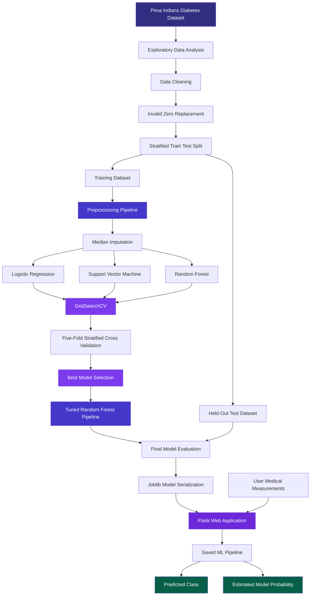
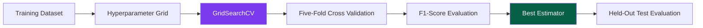
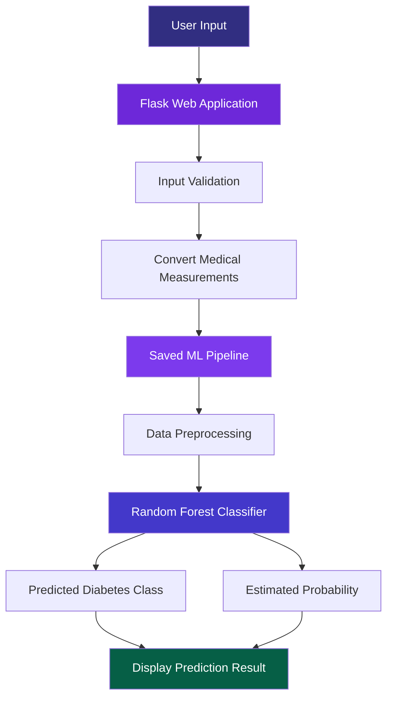

<div align="center">

# 🩺 Diabetes Prediction

### End-to-End Machine Learning System

**Healthcare Intelligence · Predictive Analytics · Machine Learning**

An end-to-end Machine Learning application that transforms medical measurements into predictive insights using an optimized Random Forest classification pipeline.

<br>


<br>


<br>

[](https://www.linkedin.com/in/dhruv-panchal-a14865258/)

[](https://github.com/dhruv4AlgoForge)

<br>

[Overview](#project-overview) •
[Features](#key-features) •
[Application](#application-preview) •
[Dataset](#dataset-information) •
[Architecture](#system-architecture) •
[Results](#model-performance) •
[Installation](#installation-and-setup)

</div>

---

## Project Overview

Diabetes Prediction is an end-to-end Machine Learning project designed to identify patterns in medical and diagnostic measurements and estimate the likelihood of diabetes using supervised classification algorithms.

The project uses the **Pima Indians Diabetes Dataset** and implements multiple Machine Learning models to evaluate their classification performance.

Three classification algorithms were implemented:

- Logistic Regression
- Support Vector Machine
- Random Forest Classifier

An optimized Random Forest model was selected based on cross-validation F1-score and integrated into a Flask-based web application for interactive predictions.

The project demonstrates the complete Machine Learning development lifecycle, including data preprocessing, exploratory data analysis, model training, hyperparameter optimization, evaluation, model serialization and application integration.

> **Medical Disclaimer:** This project is developed exclusively for educational and portfolio purposes. Predictions are not medical diagnoses and must not replace professional medical advice.

---

## Problem Statement

Diabetes is a chronic health condition that requires proper medical attention and identification.

Medical datasets contain valuable information that can be analyzed using statistical techniques and Machine Learning algorithms.

However, invalid medical measurements, missing values, class imbalance and overlapping patient characteristics can make accurate classification challenging.

This project explores how systematic preprocessing, supervised learning and model optimization can be combined to develop an interactive diabetes prediction prototype.

---

## Key Features

| Module | Capabilities |
|:---|:---|
| **Exploratory Data Analysis** | Dataset distributions, statistical analysis and feature relationships |
| **Data Cleaning** | Identification and replacement of invalid zero measurements |
| **Missing Value Handling** | Median-based imputation |
| **Data Preparation** | Stratified training and testing datasets |
| **Machine Learning** | Logistic Regression, SVM and Random Forest |
| **Hyperparameter Optimization** | GridSearchCV-based parameter selection |
| **Cross-Validation** | Five-fold StratifiedKFold validation |
| **Model Evaluation** | Accuracy, precision, recall, F1-score and ROC-AUC |
| **Model Interpretability** | Random Forest feature importance |
| **Model Persistence** | Joblib-based pipeline serialization |
| **Web Application** | Flask-based interactive prediction interface |
| **Prediction Intelligence** | Predicted diabetes class and estimated model probability |

---

## Performance at a Glance

<div align="center">

<table>
<tr>
<td align="center" width="25%">
<h2>768</h2>
Dataset Records
</td>
<td align="center" width="25%">
<h2>8</h2>
Input Features
</td>
<td align="center" width="25%">
<h2>3</h2>
ML Algorithms
</td>
<td align="center" width="25%">
<h2>5</h2>
Cross-Validation Folds
</td>
</tr>
<tr>
<td align="center">
<h2>73.38%</h2>
Test Accuracy
</td>
<td align="center">
<h2>74.07%</h2>
Recall
</td>
<td align="center">
<h2>66.12%</h2>
F1-Score
</td>
<td align="center">
<h2>82.04%</h2>
ROC-AUC
</td>
</tr>
</table>

</div>

> The final tuned Random Forest model was evaluated on a held-out test dataset containing 154 records. These results do not establish clinical effectiveness.

---

## Application Preview

### 01 — Diabetes Prediction Dashboard

<div align="center">


<br>

**Flask Web Application — Interactive Prediction Interface**

</div>

The application provides a web-based interface for entering eight medical measurements and generating predictions using the trained Machine Learning pipeline.

### Application Capabilities

- Interactive medical measurement input form
- Eight numerical input features
- Real-time local model inference
- Automated preprocessing through the saved pipeline
- Binary diabetes classification
- Estimated model probability
- Flask backend integration
- HTML and CSS frontend

<details>
<summary><b>View Application Input Parameters</b></summary>

<br>

| Input Parameter | Input Type |
|:---|:---|
| Pregnancies | Numerical |
| Glucose | Numerical |
| Blood Pressure | Numerical |
| Skin Thickness | Numerical |
| Insulin | Numerical |
| BMI | Numerical |
| Diabetes Pedigree Function | Numerical |
| Age | Numerical |

</details>

<details>
<summary><b>View Prediction Outputs</b></summary>

<br>

| Output | Description |
|:---|:---|
| Lower Predicted Diabetes Risk | Model predicts the non-diabetic class |
| Higher Predicted Diabetes Risk | Model predicts the diabetic class |
| Estimated Probability | Probability generated by the trained classification model |

The displayed probability is a statistical model estimate rather than a clinically validated individual risk assessment.

</details>

---

## System Architecture



---

## Technology Stack

<div align="center">

### Core Development Technologies


</div>

| Domain | Technologies |
|:---|:---|
| Programming | Python 3.11 |
| Data Manipulation | Pandas |
| Numerical Computing | NumPy |
| Data Visualization | Matplotlib, Seaborn |
| Machine Learning | Scikit-learn |
| Classification Algorithms | Logistic Regression, SVM, Random Forest |
| Hyperparameter Optimization | GridSearchCV |
| Cross-Validation | StratifiedKFold |
| Model Persistence | Joblib |
| Backend Development | Flask |
| Frontend Development | HTML, CSS |
| Development Environment | Jupyter Notebook |
| Version Control | Git, GitHub |

---

## Dataset Information

**Dataset:** Pima Indians Diabetes Dataset

The dataset contains medical and diagnostic measurements associated with a binary diabetes outcome.

### Dataset Summary

| Attribute | Value |
|:---|---:|
| Total Records | 768 |
| Total Columns | 9 |
| Input Features | 8 |
| Target Variables | 1 |
| Non-Diabetic Records | 500 |
| Diabetic Records | 268 |
| Problem Type | Binary Classification |

### Dataset Features

| Feature | Description |
|:---|:---|
| Pregnancies | Number of pregnancies |
| Glucose | Plasma glucose concentration |
| BloodPressure | Diastolic blood pressure |
| SkinThickness | Triceps skinfold thickness |
| Insulin | Two-hour serum insulin measurement |
| BMI | Body Mass Index |
| DiabetesPedigreeFunction | Diabetes pedigree function |
| Age | Patient age |
| Outcome | Binary diabetes outcome |

### Target Distribution

<div align="center">

<table>
<tr>
<td align="center" width="50%">
<h2>500</h2>
Non-Diabetic Records
<br>
Outcome = 0
<br><br>
65.10%
</td>
<td align="center" width="50%">
<h2>268</h2>
Diabetic Records
<br>
Outcome = 1
<br><br>
34.90%
</td>
</tr>
</table>

</div>

The target distribution is moderately imbalanced. Therefore, recall, precision, F1-score and ROC-AUC are considered alongside classification accuracy.

---

## Project Objectives

- Perform exploratory data analysis to understand dataset characteristics.
- Identify and handle missing or invalid medical measurements.
- Implement appropriate data preprocessing techniques.
- Train and compare multiple supervised classification algorithms.
- Optimize model performance using GridSearchCV.
- Evaluate models using complementary classification metrics.
- Serialize the selected Machine Learning pipeline.
- Integrate the trained pipeline into a Flask web application.
- Demonstrate end-to-end Machine Learning development.

---

## Exploratory Data Analysis

Exploratory Data Analysis was performed to understand the dataset before model development.

The analysis focuses on dataset characteristics, medical measurements, feature relationships and the distribution of diabetes outcomes.

<details>
<summary><b>View Exploratory Data Analysis Components</b></summary>

<br>

- Dataset structure and dimensions
- Feature information
- Descriptive statistical analysis
- Missing value identification
- Invalid zero value detection
- Target variable distribution
- Numerical feature analysis
- Feature relationships
- Correlation analysis

</details>

<details>
<summary><b>View Medical Feature Analysis</b></summary>

<br>

The exploratory workflow examines medical variables such as:

- Glucose concentration
- Body Mass Index
- Age
- Insulin measurements
- Blood pressure
- Skin thickness
- Pregnancy count
- Diabetes pedigree function

Feature relationships are explored to understand patterns within the dataset.

Observed associations do not establish medical causation.

</details>

---

## Data Preprocessing

Medical datasets can contain invalid values that negatively affect Machine Learning performance.

A structured preprocessing workflow was implemented to handle these issues.

### Invalid Zero Value Handling

| Medical Feature | Invalid Zero Replaced with NaN |
|:---|:---:|
| Glucose | Yes |
| BloodPressure | Yes |
| SkinThickness | Yes |
| Insulin | Yes |
| BMI | Yes |
| Pregnancies | No |
| DiabetesPedigreeFunction | No |
| Age | No |

Invalid zero values in selected medical measurements were converted into missing values.

Median imputation was subsequently used to handle the missing values.

### Preprocessing Pipeline


### Implemented Techniques

| Technique | Purpose |
|:---|:---|
| Zero-to-NaN Replacement | Handle invalid medical measurements |
| Median Imputation | Replace missing feature values |
| Stratified Data Splitting | Preserve target class distribution |
| Scikit-learn Pipelines | Maintain consistent preprocessing |
| Cross-Validation | Evaluate model generalization |

Preprocessing pipelines were used during model training and cross-validation to reduce the risk of data leakage.

---

## Training and Testing Distribution

<div align="center">

<table>
<tr>
<td align="center" width="33%">
<h2>768</h2>
Total Records
</td>
<td align="center" width="33%">
<h2>614</h2>
Training Records
</td>
<td align="center" width="33%">
<h2>154</h2>
Testing Records
</td>
</tr>
</table>

</div>

### Dataset Split

| Dataset | Non-Diabetic | Diabetic | Total |
|:---|---:|---:|---:|
| Training Dataset | 400 | 214 | 614 |
| Testing Dataset | 100 | 54 | 154 |
| **Total** | **500** | **268** | **768** |

A stratified 80:20 train-test split was used to maintain the original class distribution.

---

## Machine Learning Algorithms

Three supervised Machine Learning algorithms were implemented and evaluated.

<table>
<tr>
<td align="center" width="33%">
<h3>Logistic Regression</h3>
Probabilistic Classification
<br><br>
Baseline Model
</td>
<td align="center" width="33%">
<h3>Support Vector Machine</h3>
Margin-Based Classification
<br><br>
Decision Boundary Learning
</td>
<td align="center" width="33%">
<h3>Random Forest</h3>
Ensemble Learning
<br><br>
Selected Final Model
</td>
</tr>
</table>

<details>
<summary><b>01 — Logistic Regression</b></summary>

<br>

Logistic Regression estimates the probability of a binary outcome using a logistic function.

It serves as a useful baseline classification algorithm.

Key characteristics:

- Binary classification
- Probability estimation
- Efficient model training
- Interpretable model structure

</details>

<details>
<summary><b>02 — Support Vector Machine</b></summary>

<br>

Support Vector Machine learns a decision boundary that separates different classes.

Key characteristics:

- Margin-based learning
- Decision boundary optimization
- Support for nonlinear classification
- Effective classification in multidimensional feature spaces

</details>

<details>
<summary><b>03 — Random Forest Classifier</b></summary>

<br>

Random Forest is an ensemble learning algorithm that combines multiple decision trees to generate a final classification.

Key characteristics:

- Ensemble-based classification
- Nonlinear pattern learning
- Feature importance estimation
- Reduced dependence on individual decision trees
- Probability estimation

The tuned Random Forest pipeline was selected as the final Machine Learning model.

</details>

---

## Hyperparameter Optimization

GridSearchCV was used to identify suitable hyperparameter combinations for the evaluated classification algorithms.

### Optimization Configuration

| Parameter | Configuration |
|:---|:---|
| Search Method | GridSearchCV |
| Validation Strategy | StratifiedKFold |
| Number of Folds | 5 |
| Selection Metric | F1-Score |
| Algorithms Evaluated | 3 |
| Selected Model | Random Forest |

### Optimization Workflow



F1-score was used for model selection because it considers both precision and recall.

The held-out test dataset was reserved for final model evaluation.

---

## Model Performance

### Cross-Validation Results

| Machine Learning Model | Best CV F1-Score |
|:---|---:|
| Logistic Regression | 0.6792 |
| Support Vector Machine | 0.6902 |
| **Random Forest** | **0.7078** |

### Cross-Validation Performance Visualization

| Model | CV F1-Score | Relative Performance |
|:---|---:|:---|
| Logistic Regression | 67.92% | ██████████████░░░░░░ |
| Support Vector Machine | 69.02% | ██████████████░░░░░░ |
| **Random Forest** | **70.78%** | ██████████████░░░░░░ |

Random Forest achieved the highest cross-validation F1-score among the evaluated algorithms.

**Selected Model:** Tuned Random Forest Classifier.

---

### Final Held-Out Test Results

<div align="center">

| Evaluation Metric | Result |
|:---|---:|
| **Test Accuracy** | **73.38%** |
| Precision | 59.70% |
| Recall | 74.07% |
| F1-Score | 66.12% |
| **ROC-AUC** | **82.04%** |
| Total Test Records | 154 |
| Correct Predictions | 113 |
| Incorrect Predictions | 41 |

</div>

### Performance Visualization

| Metric | Score | Relative Performance |
|:---|---:|:---|
| Accuracy | 73.38% | ███████████████░░░░░ |
| Precision | 59.70% | ████████████░░░░░░░░ |
| Recall | 74.07% | ███████████████░░░░░ |
| F1-Score | 66.12% | █████████████░░░░░░░ |
| ROC-AUC | 82.04% | ████████████████░░░░ |

The tuned Random Forest achieved a recall of 74.07% and ROC-AUC of 82.04% on the held-out test dataset.

These results demonstrate the model's classification performance within the selected dataset, rather than its suitability for clinical diagnosis.

---

## Confusion Matrix

The final Random Forest model was evaluated on 154 unseen test records.

<div align="center">

<table>
<tr>
<th rowspan="2">Actual Class</th>
<th colspan="2">Predicted Class</th>
</tr>
<tr>
<th>Non-Diabetic</th>
<th>Diabetic</th>
</tr>
<tr>
<th>Non-Diabetic</th>
<td align="center">
<h2>73</h2>
True Negative
</td>
<td align="center">
<h2>27</h2>
False Positive
</td>
</tr>
<tr>
<th>Diabetic</th>
<td align="center">
<h2>14</h2>
False Negative
</td>
<td align="center">
<h2>40</h2>
True Positive
</td>
</tr>
</table>

</div>

### Prediction Outcomes

<div align="center">

<table>
<tr>
<td align="center" width="50%">
<h2>113</h2>
Correct Predictions
<br><br>
73.38%
</td>
<td align="center" width="50%">
<h2>41</h2>
Incorrect Predictions
<br><br>
26.62%
</td>
</tr>
</table>

</div>

<details>
<summary><b>View Confusion Matrix Interpretation</b></summary>

<br>

| Classification Outcome | Records |
|:---|---:|
| True Negative | 73 |
| False Positive | 27 |
| False Negative | 14 |
| True Positive | 40 |

The model correctly classified 73 non-diabetic cases and 40 diabetic cases.

However, 27 non-diabetic cases were incorrectly classified as diabetic, while 14 diabetic cases were incorrectly classified as non-diabetic.

These errors highlight the importance of considering multiple evaluation metrics rather than relying solely on accuracy.

</details>

---

## Feature Importance

The Random Forest classifier provides feature importance estimates that help explain the relative contribution of input features within the trained model.

### Feature Importance Ranking

| Rank | Feature | Importance |
|:---:|:---|---:|
| 01 | **Glucose** | **0.3370** |
| 02 | BMI | 0.1818 |
| 03 | Age | 0.1262 |
| 04 | Insulin | 0.1149 |
| 05 | DiabetesPedigreeFunction | 0.0764 |
| 06 | Pregnancies | 0.0595 |
| 07 | SkinThickness | 0.0532 |
| 08 | BloodPressure | 0.0511 |

### Feature Importance Visualization

| Feature | Relative Importance |
|:---|:---|
| Glucose | ████████████████████ |
| BMI | ███████████ |
| Age | ███████ |
| Insulin | ███████ |
| DiabetesPedigreeFunction | █████ |
| Pregnancies | ████ |
| SkinThickness | ███ |
| BloodPressure | ███ |

Glucose was the most influential feature in the trained Random Forest model, followed by BMI and Age.

Feature importance represents the behavior of the trained model and should not be interpreted as clinical causation.

---

## Application Workflow



The application connects the trained Machine Learning pipeline to an interactive Flask interface.

The saved pipeline processes the input medical measurements before generating a predicted class and corresponding model probability.

---

## Project Structure

```text
Diabetes-Prediction-ML/
│
├── data/
│   └── diabetes.csv
│
├── models/
│   └── diabetes_prediction_model.pkl
│
├── notebooks/
│   └── diabetes_analysis.ipynb
│
├── src/
│
├── static/
│   └── style.css
│
├── templates/
│   └── index.html
│
├── app.py
├── requirements.txt
├── .gitignore
└── README.md
```

### Project File Description

| File / Folder | Purpose |
|:---|:---|
| data/ | Original medical dataset |
| models/ | Serialized Machine Learning model |
| notebooks/ | EDA, preprocessing, training and evaluation |
| src/ | Source code directory |
| static/ | Frontend styling resources |
| templates/ | Flask HTML templates |
| app.py | Flask application and prediction logic |
| requirements.txt | Required Python dependencies |
| .gitignore | Excludes unnecessary development files |
| README.md | Complete project documentation |

---

## Model Serialization

The selected Machine Learning pipeline was saved using Joblib.

```text
models/diabetes_prediction_model.pkl
```

The serialized artifact allows the application to load the trained classification pipeline without retraining the model each time the application starts.

### Engineering Benefits

- Reusable trained model
- Consistent preprocessing during inference
- Faster application initialization
- Separation of model training and prediction
- Simplified application integration

---

## Installation and Setup

### 1. Clone the Repository

```bash
git clone https://github.com/dhruv4AlgoForge/Diabetes-Prediction-ML.git
```

### 2. Navigate to the Project Directory

```bash
cd Diabetes-Prediction-ML
```

### 3. Create a Virtual Environment

```bash
python -m venv venv
```

### 4. Activate the Virtual Environment

**Windows PowerShell**

```powershell
.\venv\Scripts\Activate.ps1
```

**Windows Command Prompt**

```cmd
venv\Scripts\activate
```

**Linux / macOS**

```bash
source venv/bin/activate
```

### 5. Install Dependencies

```bash
python -m pip install -r requirements.txt
```

### 6. Launch the Flask Application

```bash
python app.py
```

### 7. Open the Application

Visit the following URL in your browser:

```text
http://127.0.0.1:5000/
```

### 8. Explore the Jupyter Notebook

```bash
python -m jupyter notebook
```

Navigate to:

```text
notebooks/diabetes_analysis.ipynb
```

Install Jupyter Notebook separately if it is not included in your environment.

The notebook contains the exploratory data analysis, preprocessing, model development, hyperparameter tuning and evaluation workflow.

---

## Engineering Highlights

| Challenge | Implemented Approach |
|:---|:---|
| Invalid medical measurements | Zero-to-NaN replacement |
| Missing feature values | Median imputation |
| Class distribution preservation | Stratified train-test splitting |
| Model selection | Comparison of three classification algorithms |
| Hyperparameter optimization | GridSearchCV |
| Data leakage risk | Pipeline-based preprocessing |
| Model validation | Five-fold StratifiedKFold |
| Classification evaluation | Multiple complementary evaluation metrics |
| Model interpretation | Random Forest feature importance |
| Model reusability | Joblib serialization |
| Application integration | Flask web framework |
| Interactive prediction | HTML and CSS web interface |

---

## Project Learning Outcomes

<details>
<summary><b>Data Science and Exploratory Analysis</b></summary>

<br>

- Exploratory data analysis
- Statistical analysis
- Dataset preparation
- Missing value handling
- Invalid measurement detection
- Feature relationships
- Class distribution analysis

</details>

<details>
<summary><b>Machine Learning Development</b></summary>

<br>

- Supervised classification
- Logistic Regression
- Support Vector Machine
- Ensemble learning
- Random Forest
- Hyperparameter tuning
- GridSearchCV
- Cross-validation
- Confusion matrix analysis
- ROC-AUC evaluation
- Feature importance

</details>

<details>
<summary><b>Software Engineering and Application Development</b></summary>

<br>

- Python programming
- Flask backend development
- HTML and CSS frontend integration
- Machine Learning model serialization
- Application-based model inference
- Dependency management
- GitHub project documentation

</details>

---

## Limitations

- The dataset contains only 768 observations.
- The dataset represents a specific population and may not generalize to other demographic groups.
- Invalid medical measurements require imputation.
- The dataset has an imbalanced target distribution.
- The model produces both false-positive and false-negative predictions.
- Estimated probabilities are not clinically validated risk measurements.
- The model has not undergone external clinical validation.
- Feature importance does not establish medical causation.
- Model performance may vary on other healthcare datasets.
- The Flask application is an educational prototype rather than a clinical diagnostic product.

---

## Future Roadmap

- [ ] Experiment with advanced ensemble learning algorithms
- [ ] Implement XGBoost and LightGBM experiments
- [ ] Improve diabetic-class precision while maintaining recall
- [ ] Explore additional feature selection methods
- [ ] Implement probability calibration
- [ ] Explore SHAP-based model explainability
- [ ] Add interactive model performance visualizations
- [ ] Develop an enhanced application interface
- [ ] Implement REST API integration
- [ ] Docker-based containerization
- [ ] AWS cloud deployment
- [ ] Evaluate larger and more diverse healthcare datasets

---

## Dataset Credits

**Pima Indians Diabetes Dataset**

The dataset is used for educational Machine Learning experimentation, statistical analysis and binary classification.

Refer to the original dataset documentation and applicable usage and redistribution conditions.

---

## Author

<div align="center">


### Dhruv Panchal

**Master of Computer Applications (MCA)**

AI & ML Enthusiast | Machine Learning | Data Science | Python Developer

Passionate about developing intelligent applications, exploring Machine Learning algorithms and transforming data into meaningful solutions.

<br>

[](https://www.linkedin.com/in/dhruv-panchal-a14865258/)

[](https://github.com/dhruv4AlgoForge)

[](https://intellisyslabs.online/)

</div>

---

## Explore My Other Projects

<div align="center">

<a href="https://github.com/dhruv4AlgoForge/Customer_Support_Intelligence_NLP">

</a>

<br>

**SupportIQ — Customer Support Intelligence System**

Natural Language Processing · Machine Learning · Streamlit

23 NLP Techniques | 27 Customer Intents | 99.28% Test Accuracy

[Explore SupportIQ](https://github.com/dhruv4AlgoForge/Customer_Support_Intelligence_NLP)

</div>

---

## Acknowledgements

- Pima Indians Diabetes Dataset contributors
- Scikit-learn — Machine Learning Framework
- Pandas — Data Manipulation
- NumPy — Numerical Computing
- Matplotlib — Data Visualization
- Seaborn — Statistical Visualization
- Joblib — Model Serialization
- Flask — Web Application Development
- Jupyter — Interactive Machine Learning Experimentation

---

<div align="center">

### 🩺 Diabetes Prediction

**Transforming Medical Data into Predictive Intelligence**

[](https://github.com/dhruv4AlgoForge/Diabetes-Prediction-ML)

If you found this project interesting, consider giving the repository a ⭐.

<br>

Developed by **Dhruv Panchal**

[LinkedIn](https://www.linkedin.com/in/dhruv-panchal-a14865258/) |
[GitHub](https://github.com/dhruv4AlgoForge) |
[Portfolio](https://intellisyslabs.online/)

</div>
